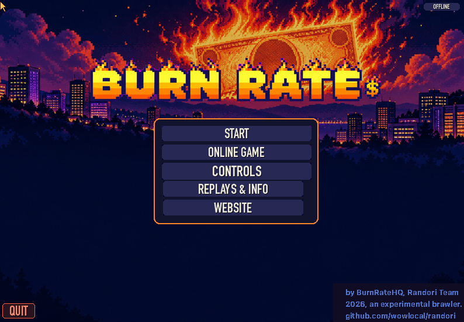
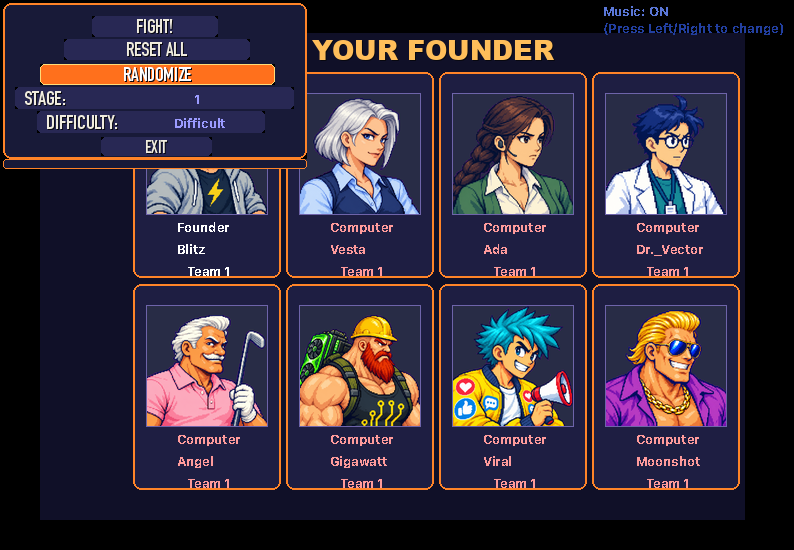
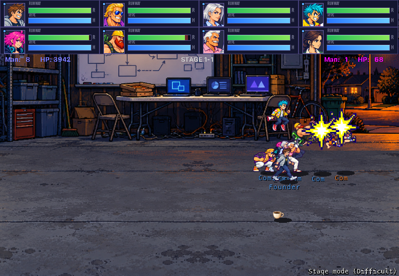
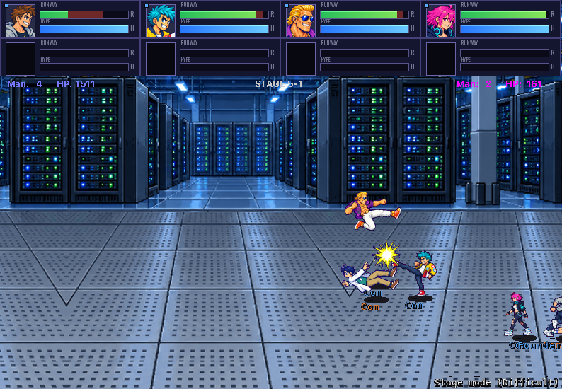
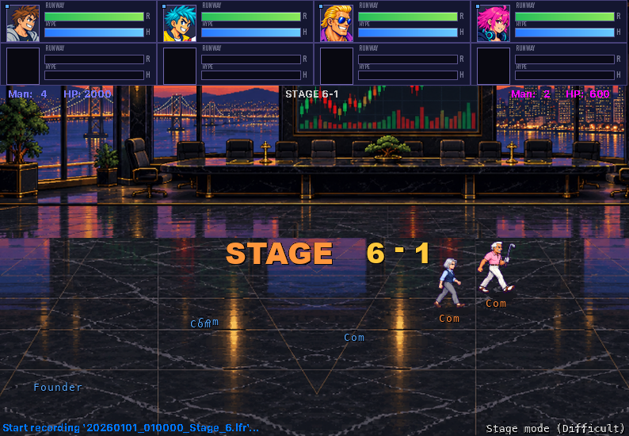
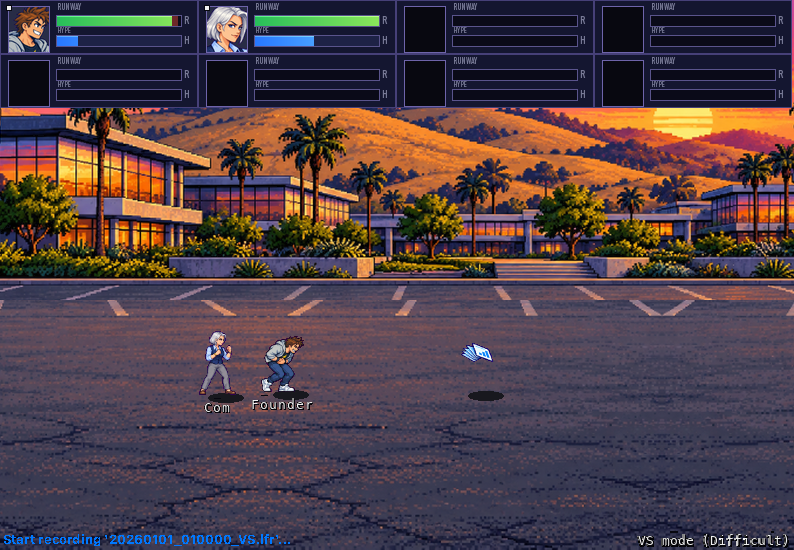

# Burn Rate

An experimental 2D brawler on the [Randori](https://github.com/wowlocal/randori)
engine: Silicon Valley AI startup founders fight over the last round of
funding. Every fighter is a fictional archetype, not a real person. All art
was generated with Codex CLI's image generation and processed by the scripts
here; all sounds and music are synthesized. Nothing comes from another game.



| | |
| --- | --- |
|  |  |
|  |  |



The screenshots are frames captured from scripted runs of the macOS app.

## The founders

| Fighter | Archetype | Signature (D > A) |
| --- | --- | --- |
| Blitz | hoodie wunderkind CEO | Pitch Deck: a fan of slides |
| Dr. Vector | ML researcher | Gradient Beam: an energy ball |
| Vesta | VC in a fleece vest | Term Sheet: a rolled contract |
| Moonshot | ex-crypto hype bro | Pump: a gold coin |
| Ada | AI-safety lead | Guardrail: a hexagon shield |
| Gigawatt | GPU-hoarding compute baron | a GPU card (slow, strong) |
| Prompt | prompt-engineer streamer | a chat bubble (fast) |
| Intern | tireless intern | an energy-drink can (fastest, light) |
| Angel | angel investor | a golf ball |
| Viral | growth hacker | a megaphone sound wave |

Every founder also has D ^ A, a launching uppercut. Specials cost Hype (MP).

## Story: the Last Round

Omega Capital announces Series Ω, one check big enough to end the runway
problem forever, for the founder still standing in its boardroom on closing
day. Stage Mode plays the campaign in six acts of four missions each. Each
act ends with a boss: Blitz, Moonshot, Vesta, Ada, Gigawatt, and then
Omega's board. The ending depends on the difficulty. The settings screen's
STAGE row picks the act to start from. The design, with every mission's
line-up, is in [docs/STORY.md](docs/STORY.md).

| Act | Arena | Boss |
| --- | --- | --- |
| 1 Pre-Seed | the Garage | Blitz, the Wunderkind |
| 2 Seed | Demo Day | Moonshot, the Hype Man |
| 3 Series A | Sand Hill Road | Vesta, the Down Round |
| 4 Hypergrowth | the Open Office | Ada, the Safety Review |
| 5 The Compute War | the Server Farm | Gigawatt, the Compute Baron |
| 6 The Last Round | the Board Room | Series Ω: Vesta and Gigawatt |

## Arenas

Demo Day, Sand Hill Road, Server Farm, Open Office, Garage, Board Room, and
the engine's own road (Highway 101). VS can use any of them.

## Controls (player 1)

Arrows move (double-tap to run), A attacks, S jumps, D defends. Specials are
D, then a direction, then A. Player 2: T F G H, Z X C. Esc quits, F4 returns
to the menu.

## Build

Needs macOS 14+, Swift 6.4 (Xcode with the 6.4 toolchain) and Python 3 with
Pillow and NumPy. The engine is the `Vendor/randori` submodule:

```sh
git clone --recursive https://github.com/wowlocal/burn-rate.git
cd burn-rate
tools/build.sh                 # content, executables and BurnRate.app in build/
open build/BurnRate.app
```

`tools/build.sh BUILD_DIR` builds elsewhere; `BURNRATE_PYTHON` names the
Python (default `python3`) and `BURNRATE_TOOLCHAIN` a Swift toolchain's
`bin` (default Xcode's). `tools/smoke.sh` (a scripted match) and
`tools/playtest.py` (every founder and every mode, headless) check a build.

`tools/build.sh` stages the content (`tools/content/stage.py`: DATs, sprite
sheets, interface, sounds, music), runs `BurnRateContentBuilder` (the
engine's eight content packages and `GeneratedIdentity.swift`), builds the
app and the headless host, and assembles the app bundle. The raw art is in
`art/raw` (half-size copies made by `tools/art/archive.py`);
`tools/art/generate.py` and `generate_misc.py` make the full-size originals
with Codex CLI into `$BURNRATE_RAW`, and the same variable points the
build at them.

See [docs/PLAN.md](docs/PLAN.md) for the plan and its ledger,
[docs/ENGINE_CONTRACT.md](docs/ENGINE_CONTRACT.md) for what a game gives the
engine and [docs/INTERFACE_SLOTS.md](docs/INTERFACE_SLOTS.md) for the
interface's slots.

## License

MIT, see [LICENSE](LICENSE): the code, the art in `art/`, the sounds and the
music. The engine, [Randori](https://github.com/wowlocal/randori), is a
separate project under the Apache License 2.0 (`Vendor/randori/LICENSE` and
`NOTICE`).
